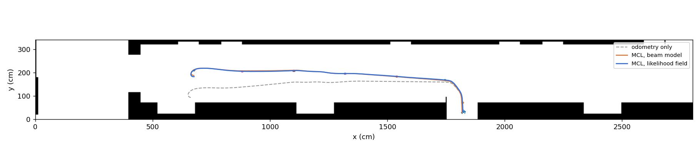

# Monte Carlo Localization

Particle-filter localization of a mobile robot in a hallway, from a real
odometry + laser log, with an interactive website that teaches every step by
simulation.

**Website:** https://sundarrajnitish.github.io/Monte-Carlo-Localization/

The site lets you localize the robot by hand, run a 1-D Bayes filter, sample
the odometry motion model, tune the beam and likelihood-field sensor models,
watch resampling pointers, and drive a simulated robot through the real map
(including kidnapping it). All numbers below are reproduced by
`python/scripts/run_experiments.py` with fixed seeds.

## The problem

| | |
|---|---|
| Map | 700 × 85 occupancy grid, 4 cm cells (28 m × 3.4 m hallway) |
| Log | 45 s: 522 odometry records, 240 laser scans of 180 beams (1° apart, right to left) |
| Sensor | laser 25 cm ahead of the robot centre, max range 8183 cm |
| Unknown | the transform between the robot's odometry frame and the map |

## Algorithm

Monte Carlo Localization (*Probabilistic Robotics*, Table 8.2) with:

* **Odometry motion model** (Table 5.6): (δrot1, δtrans, δrot2) with noise
  variances scaled by α₁…α₄, plus handling for pure rotation and reversing.
* **Two sensor models**: the beam model (ray casting by sphere tracing over a
  distance transform; hit / short / max / random mixture) and the
  likelihood-field (end-point) model over an exact Euclidean distance
  transform.
* **Log-space weights** with log-sum-exp normalisation, every 5th beam, and an
  optional likelihood *temperature* to counter correlated beams.
* **Adaptive low-variance resampling** (only when N_eff < M/2), plus
  stratified and multinomial for comparison.
* **Scan gating**: a scan is only integrated after 5 cm or 5° of motion.
* **Augmented MCL** (Table 8.3) with w_slow / w_fast random-particle injection
  for the kidnapped robot problem.
* **Robust pose estimate**: weighted mean of the dominant mode, not of the
  whole (possibly multi-modal) cloud.

## Findings

| # | Finding |
|---|---|
| 1 | On the real log, MCL keeps the median scan end-point **4 cm** from a wall (one cell); odometry alone: **36 cm**, and it ends **89 cm** from the filter's final pose after 12.9 m. Beam and likelihood-field estimates agree to 3.0 cm on average. |
| 2 | Global localization (uniform start, 20 seeds): 1000 particles succeed only **4–5 / 20**; 3000 particles **10–14 / 20**. A likelihood temperature of 10–30 helps (10 → 14 / 20 at N = 3000). Failures converge confidently onto a look-alike stretch of corridor. |
| 3 | Tracking accuracy (synthetic, known truth) plateaus early: likelihood field ≈ **6–7 cm** RMSE from ~250 particles; beam model keeps improving to **2.6 cm** at 1000 particles. |
| 4 | Cost at 1000 particles (Python/NumPy): likelihood field **2.3 ms/scan**, beam model **21 ms/scan**. |
| 5 | MCL error is anisotropic: 5.4 cm along the corridor vs 2.7 cm across it. Its own particle spread (2.1 cm) is smaller than its RMSE (6.0 cm): the filter is over-confident because beams are not independent. Dead reckoning reaches 9.4 m of error over the same 33 m tour. |
| 6 | Kidnapped robot: standard MCL recovers in **0 / 5** runs, augmented MCL in **5 / 5** (median 24 scans). |
| 7 | Resampler choice barely changes RMSE at 200 particles; low-variance keeps the most distinct particles (39 vs 33–35 for multinomial). |
| 8 | Odometry appears twice in the log (`O` records and stamped on `L` records, lagging by one reading). Merging them would double the path (28.0 m vs 13.0 m) and fake 218 reversals, so the filter uses the scan-stamped odometry only. |



## Repository layout

```
data/                 hallway_map.txt (85 rows, top row first), robotdata.log
python/mcl/           reference implementation (NumPy/SciPy)
python/tests/         pytest suite
python/scripts/       run_localization.py (animate), run_experiments.py (all findings)
matlab/               toolbox-free MATLAB port, also runs in GNU Octave
docs/                 the website (GitHub Pages), JS port in docs/js/core.js
results/              results.json and figures written by run_experiments.py
```

Coordinate frame everywhere: x right, y up, centimetres, origin at the map's
bottom-left corner.

## Run it

```bash
cd python
pip install -r requirements.txt
python -m pytest -q                          # 21 tests
python scripts/run_localization.py           # animate tracking on the real log
python scripts/run_localization.py --global --particles 3000 --temperature 30
python scripts/run_experiments.py            # regenerate results/ and docs/data/ (~8 min)
```

```matlab
cd matlab
run_mcl      % animated filter on the real log (base MATLAB R2016b+ or Octave 6+)
test_mcl     % self-checks
```

Website locally: `python -m http.server -d docs` and open http://localhost:8000.

## References

* S. Thrun, W. Burgard, D. Fox. *Probabilistic Robotics*. MIT Press, 2005.
* F. Dellaert, D. Fox, W. Burgard, S. Thrun. "Monte Carlo Localization for Mobile Robots." ICRA 1999.
* P. Felzenszwalb, D. Huttenlocher. "Distance Transforms of Sampled Functions." *Theory of Computing*, 2012.
